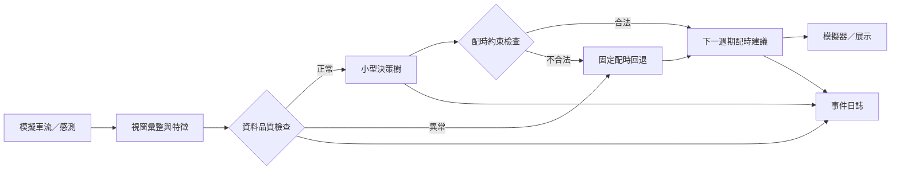

# 02｜系統設計與決策流程

## 1. 範圍與假設
- NS、EW 互斥直行相位；一次僅一軸放行。
- 在完整號誌週期或預定安全決策邊界才更新配時，不能瞬間跳燈。
- 黃燈、全紅、最小／最大綠燈均屬必要約束；原型可抽象化，實場不可繞過。
- 模擬器應分開提供交通真值與感測估計值，以評估誤差。

## 2. 流程架構


## 3. 特徵 schema
| 特徵 | 單位／型別 | 說明 |
|---|---|---|
| `ns_arrivals_window`, `ew_arrivals_window` | 輛／視窗 | 各軸近期到車量 |
| `ns_queue_est`, `ew_queue_est` | 輛 | 目前估計隊列 |
| `ns_wait_est`, `ew_wait_est` | 秒 | 等待壓力，需明確定義平均或累積 |
| `arrival_delta` | 輛 | NS 到車數 − EW 到車數 |
| `queue_delta` | 輛 | NS 佇列 − EW 佇列 |
| `data_valid` | 布林 | 有效性與時效檢查是否通過 |

訓練、主機推論與板端需共用特徵規格與單位。

## 4. 策略輸出
| ID | 策略 | 行為 |
|---|---|---|
| 0 | `BALANCED` | 基準 NS/EW 綠燈比例 |
| 1 | `NS_PRIORITY` | 在限制內增加 NS 綠燈 |
| 2 | `EW_PRIORITY` | 在限制內增加 EW 綠燈 |

模型輸出的是**有限配時模板**，不是任意秒數。週期、綠燈、黃燈、全紅參數由設定檔管理並在正式測試前凍結。

## 5. 決策樹訓練與解釋
1. 建立訓練資料與策略標籤；可離線比較三個策略的模擬成本，以最佳策略作標籤。
2. 以獨立驗證集選樹深度、葉節點大小；正式測試種子不得參與調參。
3. 記錄每次分類的完整決策路徑（例如 `queue_delta > threshold → NS_PRIORITY`）。
4. 監測方向飢餓、連續優先與策略震盪，設等待上限或切換限制。

## 6. Fallback 條件
關鍵欄位缺失、超出合理範圍、資料逾時、推論逾時、模型載入失敗、分類非法、狀態超出設計域或模板違反約束，均進入回退。僅在安全邊界使用預先驗證的固定配時；記錄原因、觸發時間和恢復條件。

## 7. ARM／FPGA
- **ARM**：資料處理、推論、儀表板、日誌。
- **FPGA（可選）**：計數、特徵累加、計時器或樹節點比較。
- 若需要跨裝置介面，需明定 AXI-Lite／寄存器、valid／ready 與逾時行為。

## 8. 日誌示例
```json
{
 "run_id":"scenario_seed_policy",
 "timestamp_ms":0,
 "scenario":"ns_heavy",
 "seed":42,
 "policy":"decision_tree",
 "ns_arrivals_window":0,
 "ew_arrivals_window":0,
 "ns_queue_est":0,
 "ew_queue_est":0,
 "chosen_strategy":"BALANCED",
 "decision_path":"node0 -> leaf1",
 "fallback":false,
 "fallback_reason":null,
 "inference_latency_us":0
}
```
此處零值僅是資料格式範例，不是實測數據。
